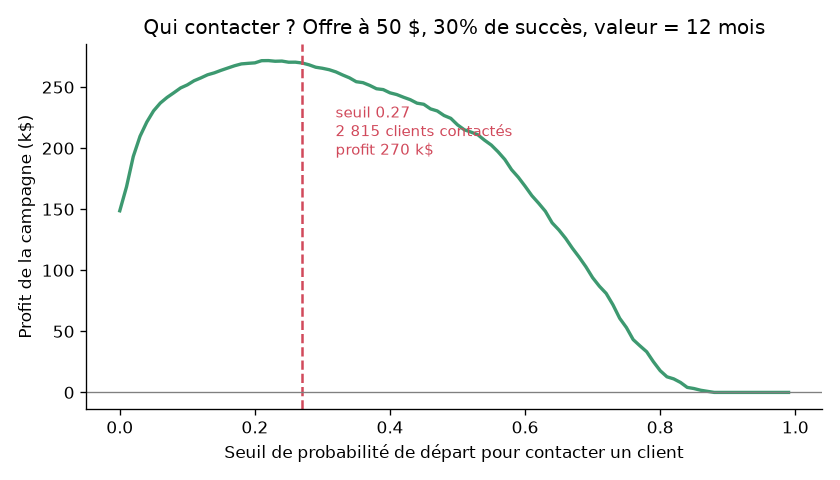
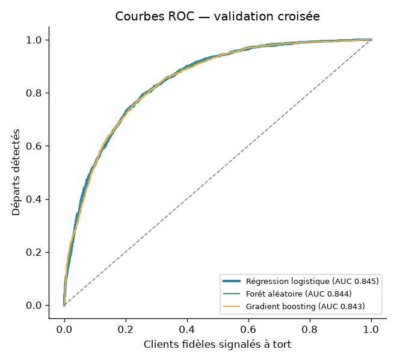
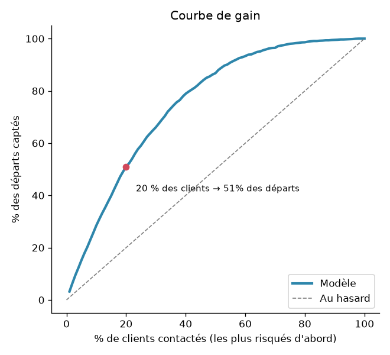
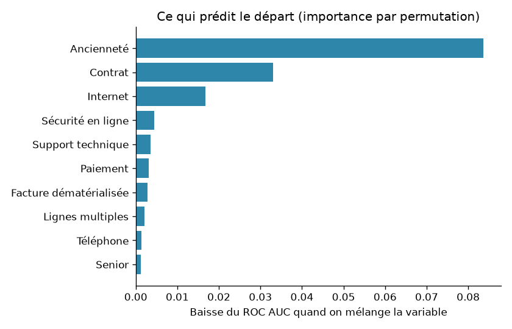

<div align="center">

# 📉 Churn Prediction

**Prédire quels clients vont partir, expliquer pourquoi, et décider qui contacter pour maximiser le profit d'une campagne de rétention.**

Machine Learning (scikit-learn) · tableau de bord **Power BI** (projet `.pbip`, exportable en `.pbit`) · données Telco d'IBM


</div>

---

## 📌 Sommaire
- [Le problème](#-le-problème)
- [Résultats](#-résultats)
- [La démarche, étape par étape](#-la-démarche-étape-par-étape)
- [Le tableau de bord Power BI](#-le-tableau-de-bord-power-bi)
- [Lancer le projet](#-lancer-le-projet)
- [Organisation du code](#-organisation-du-code)
- [Limites et pistes](#-limites-et-pistes)

---

## 🎯 Le problème

Un opérateur télécom perd **26,5 % de ses clients**, soit **31 % de son revenu mensuel**.
Il peut leur proposer une offre de rétention, mais chaque offre coûte de l'argent : **qui faut-il contacter ?**

Le projet répond à trois questions :
1. **Qui va partir ?** Une probabilité de départ pour chacun des 7 043 clients.
2. **Pourquoi ?** Les 2 principaux motifs de départ de chaque client, pour que le conseiller sache quoi proposer.
3. **Qui contacter ?** Le seuil de ciblage qui **maximise le profit** de la campagne, pas un seuil arbitraire à 50 %.

**Données** : [Telco Customer Churn](https://github.com/IBM/telco-customer-churn-on-icp4d) (IBM, licence Apache 2.0) :
7 043 clients, leurs services, leur contrat, leur facture, et s'ils sont partis.

---

## 📊 Résultats

| | |
|---|---|
| **Modèle retenu** | Régression logistique (à égalité avec une forêt aléatoire et un gradient boosting, mais explicable) |
| **ROC AUC (test)** | **0,84** · PR AUC 0,63 |
| **Départs détectés** | **78 %**, en contactant 40 % des clients |
| **Lift** | le top 10 % des clients les plus risqués contient **2,8 fois** plus de départs que la moyenne |
| **Profit de la campagne (test)** | **51 550 $**, contre 27 524 $ en contactant tout le monde (**×1,9**) |



---

## 🔬 La démarche, étape par étape

### 1. Exploration → [`notebooks/exploration.ipynb`](notebooks/exploration.ipynb)
Le profil du client qui part :
- contrat **mensuel** : 43 % de départs, contre **3 %** pour un contrat de 2 ans ;
- **nouveau client** : 53 % de départs les 6 premiers mois ;
- **fibre optique** (42 %) et paiement par **chèque électronique** (45 %).

À l'inverse, les options **sécurité en ligne** et **support technique** divisent le risque par près de trois (42 % → 15 %).

### 2. Deux variables retirées du modèle, et pourquoi
C'est l'étape la plus instructive du projet. Une première version du modèle donnait des motifs absurdes :
pour 1 858 clients, « total facturé élevé » apparaissait comme la principale raison de partir.

L'enquête a montré deux redondances :
- la **facture mensuelle** est entièrement déterminée par les services souscrits (**R² = 0,999**) : c'est leur prix ;
- le **total facturé** ≈ ancienneté × facture mensuelle (corrélation de 0,83 avec l'ancienneté).

Les garder rendait les coefficients instables (le modèle compense une variable par une autre).
Elles sont donc **retirées du modèle**, pour un coût négligeable (AUC 0,845 → 0,843), et gardées pour calculer la **valeur de chaque client**.
Le **genre** n'est pas utilisé non plus : il n'apporte rien au métier.

### 3. Comparaison de 3 modèles (validation croisée à 5 plis)
| Modèle | ROC AUC | PR AUC |
|---|:-:|:-:|
| **Régression logistique** | **0,845** ± 0,012 | 0,660 |
| Forêt aléatoire | 0,845 ± 0,008 | 0,653 |
| Gradient boosting | 0,844 ± 0,012 | 0,660 |

Les trois modèles sont **à égalité**. La règle fixée à l'avance retient la régression logistique dans ce cas :
plus simple, plus stable, et ses motifs sont **exacts** (voir étape 5).



### 4. Qui contacter ? Le seuil qui maximise le profit
Hypothèses de la campagne (modifiables dans [`src/churn/model.py`](src/churn/model.py)) :
- une offre de rétention coûte **50 $** par client contacté ;
- elle convainc **30 %** des clients qui allaient partir ;
- un client conservé rapporte **12 mois** de facture.

Pour chaque seuil, on calcule : gain (départs évités × valeur) − coût (clients contactés × 50 $).
Le seuil optimal, choisi sur des prédictions hors échantillon, est de **27 %** de probabilité de départ.

| Stratégie | Profit (jeu de test) |
|---|:-:|
| Ne contacter personne | 0 $ |
| Contacter tout le monde | 27 524 $ |
| **Contacter les clients au-dessus de 27 %** | **51 550 $** |



En contactant les **20 %** de clients les plus risqués, on capte **51 %** des départs.

### 5. Expliquer chaque client : les motifs de départ
Pour une régression logistique, la contribution de chaque variable se calcule **exactement** :
coefficient × (valeur du client − valeur moyenne). Ce sont les **valeurs SHAP linéaires**.
On garde les 2 contributions qui augmentent le plus le risque.

> 💡 Une première méthode comparait chaque client au client « le plus fréquent ». Mais ce client-là est justement en contrat mensuel,
> avec la fibre et un paiement par chèque électronique, c'est-à-dire les valeurs les plus risquées. Le contrat ne ressortait donc jamais comme motif.
> Comparer à la **moyenne** corrige ce biais.

Exemple de sortie :
| Client | Probabilité | Segment | Motif 1 | Motif 2 |
|---|:-:|:-:|---|---|
| 9237-HQITU | 69 % | Élevé | Ancienneté : 2 mois | Contrat : Mensuel |
| 5575-GNVDE | 5 % | Faible | Support technique : Non | Sauvegarde en ligne : Non |



### 6. Des scores honnêtes pour tout le portefeuille
Les 7 043 clients envoyés à Power BI sont notés par **validation croisée à 10 plis** : chaque client est noté
par un modèle qui ne l'a **jamais vu** pendant l'entraînement. Sinon, les scores affichés seraient trop optimistes.

---

## 📈 Le tableau de bord Power BI

Fichier : **[`powerbi/churn_dashboard.pbip`](powerbi/churn_dashboard.pbip)** · mode d'emploi : [`powerbi/GUIDE.md`](powerbi/GUIDE.md)

Double-cliquez sur `churn_dashboard.pbip`, puis **Accueil → Actualiser**. Les données sont **intégrées au rapport** : aucun chemin à configurer.
Pour un modèle `.pbit` : **Fichier → Exporter → Modèle Power BI**.

| Page | Contenu |
|---|---|
| **Vue d'ensemble** | Clients, taux de churn, revenu perdu · taux de churn par contrat, ancienneté, paiement, internet · filtre par contrat |
| **Clients à risque** | Clients à risque élevé, clients à contacter, revenu à risque, gain attendu · segments · **liste des clients à appeler en priorité, avec leurs motifs** |
| **Modèle et campagne** | Profit selon le seuil · courbe de gain · importance des variables · comparaison des modèles |

**11 mesures DAX** (taux de churn, revenu mensuel à risque, gain attendu de la campagne…) sont détaillées dans le guide.

Le rapport est au format **Power BI Project (`.pbip`)**, le format texte officiel de Power BI Desktop :
le modèle (`model.bim`) et les pages (`report.json`) sont des fichiers JSON lisibles et versionnés dans Git.
Ils sont **générés par un script** ([`powerbi/build_pbip.py`](powerbi/build_pbip.py)), et la CI vérifie que chaque visuel
pointe vers une colonne ou une mesure qui existe, et que chaque table correspond à son CSV.

> 💡 **Pourquoi `.pbip` et pas un `.pbit` généré directement ?** Un `.pbit` contient une partie binaire (`DataMashup`)
> au format non documenté, que Power BI vérifie à l'ouverture. Générer un `.pbit` « à la main » est fragile ;
> le `.pbip` est le format prévu pour le code et Git, et Power BI en exporte un `.pbit` propre en un clic.

---

## 🚀 Lancer le projet

**Prérequis** : Python 3.11 ou plus récent ; Power BI Desktop (Windows) pour le tableau de bord.

**Windows, en un double-clic** : `lancer.bat` installe tout, entraîne le modèle, exporte les données et génère le projet Power BI.

**À la main :**
```bash
python -m venv .venv
# Windows : .venv\Scripts\activate     macOS / Linux : source .venv/bin/activate
pip install -r requirements.txt

cd src
python -m churn.train                                             # entraînement + exports Power BI (~30 s)
python -m churn.predict ../data/raw/telco_churn.csv scores.csv    # scorer un fichier de clients
cd ..
python powerbi/build_pbip.py                                      # régénérer le projet Power BI
pytest -v                                                         # 8 tests
```

---

## 🗂️ Organisation du code

```
churn-prediction/
├── data/raw/telco_churn.csv        Données d'origine (IBM), non modifiées
├── src/churn/
│   ├── data.py                     Nettoyage, traduction en français, choix des variables
│   ├── model.py                    Pipelines, hypothèses de campagne, profit, gain, lift, motifs (SHAP linéaire)
│   ├── train.py                    Comparaison, seuil, évaluation, scores du portefeuille, exports, figures
│   └── predict.py                  Scorer de nouveaux clients
├── powerbi/
│   ├── churn_dashboard.pbip        Projet Power BI à ouvrir (3 pages, 22 visuels, 11 mesures DAX)
│   ├── churn_dashboard.SemanticModel/   Modèle : tables, requêtes Power Query, mesures DAX (model.bim)
│   ├── churn_dashboard.Report/          Pages et visuels (report.json)
│   ├── build_pbip.py               Générateur du projet
│   ├── GUIDE.md                    Mode d'emploi, mesures DAX, procédure de secours
│   └── data/                       Tables lues par Power BI (clients, courbes, importance…)
├── models/model.joblib             Modèle entraîné + seuil + données de référence
├── reports/                        metrics.json et figures
├── notebooks/exploration.ipynb     Exploration des données
├── tests/test_churn.py             8 tests : données, profit, gain, exports, cohérence du rapport Power BI
├── lancer.bat
└── .github/workflows/ci.yml        Entraînement + génération du projet Power BI + tests à chaque push
```

---

## 🧭 Limites et pistes

- Les **hypothèses de la campagne** (50 $, 30 % de succès, 12 mois) sont illustratives : avec de vraies données de campagne,
  il faudrait les estimer, idéalement par un test A/B.
- Le modèle prédit **qui** part, pas **qui sera convaincu** par l'offre. L'étape suivante est un modèle d'**uplift**,
  qui cible les clients sur lesquels l'offre change vraiment la décision.
- Les données sont une photo à un instant donné : en production, il faudrait réentraîner régulièrement et suivre la dérive.
- Pistes : API de scoring (FastAPI), actualisation automatique du rapport Power BI.

---

## 👤 Auteur

**Elie Samson Kombiwo** — Data Scientist (MLOps / LLMOps)
[GitHub](https://github.com/gitsam1path) · [LinkedIn](https://www.linkedin.com/in/elie-samson-kombiwo-4075a4284)

<sub>Données : IBM, Telco Customer Churn ([dépôt d'origine](https://github.com/IBM/telco-customer-churn-on-icp4d), licence Apache 2.0).</sub>
